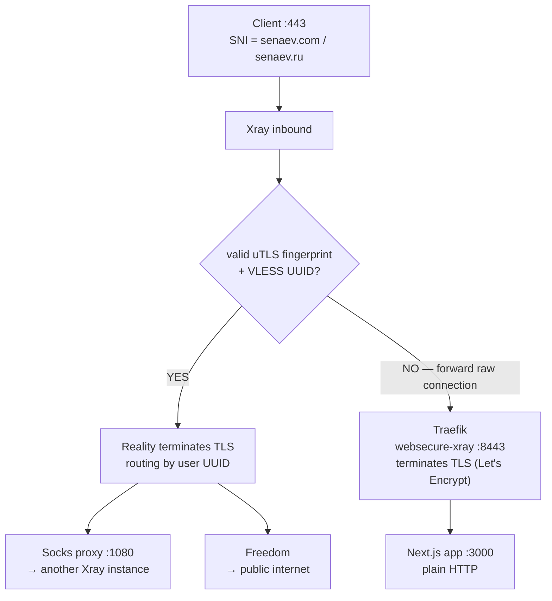

# VPN Architecture

Xray VPN with VLESS+Reality protocol, deployed across 3 nodes. Clients receive connection configs via the `vpn-subscription` web service.

Key generation: see `XRAY_VPN.md`.

## Components

### Xray VPN servers (3 instances)

Each instance runs as a Kubernetes Deployment in the `vpn` namespace (release `vpn`, chart `provisioning/helm/vpn`) on its respective node:

Inter-instance routing uses internal Socks proxies (port 1080). Instances chain traffic to each other before exiting to the internet.

### vpn-subscription service

Node.js/Fastify service at `vpn-subscription.senaev.com`. Authenticated by a secret URL path (`VPN_SUBSCRIPTION_SECRET`).

**GET `/:secret`** — returns connection config or HTML instructions based on `User-Agent`:
- VPN apps (HiddifyNext, Happ): subscription body with 5 VLESS entries
- Browsers: HTML page with setup instructions and deep links

**POST `/:secret`** — receives error reports from clients, forwards to Telegram via `cluster-helper`.


## Network flow

Port 443 on each VPS serves both the public website and VPN clients. Traefik routes by SNI: TLS connections that match the VPN SNI are passed through raw to Xray (Reality terminates TLS); everything else has TLS terminated by Traefik (Let's Encrypt) and is forwarded plain HTTP to the Next.js app.



## Config rendering

Xray config is generated at pod start by an initContainer (node:22-alpine):

1. ConfigMap holds the config template with placeholders: `{XRAY_REALITY_PRIVATE_KEY}`, `{XRAY_USER_UUID:seed}`
2. InitContainer substitutes secrets from environment variables
3. UUID derivation: `SHA256(baseUUID:seed).substring(0,32)` formatted as UUID — same logic used in both Xray config and `vpn-subscription`
4. Final config written to `/etc/xray/config.json`

## Secrets

All secrets live in HashiCorp Vault under key `senaev-com-kv`, synced to the `vpn` namespace via the existing ClusterSecretStore and ExternalSecrets operator.
The Vault store and property names are unchanged. The new namespaced Kubernetes secret
contains only VPN properties; the old shared secret is left unchanged during migration
to avoid reloader restarts of unrelated services.

The subscription service keeps its existing `http://cluster-helper` URL via an ExternalName
Service pointing to `cluster-helper.senaev-com.svc.cluster.local`. NetworkPolicy permits
subscription pods in `vpn` and the old namespace during cutover/rollback. Website fallback
ingresses remain in `senaev-com`; Xray already uses fully qualified Traefik service names.

See [cutover and rollback](projects/2026-06-10-debug-vpn-connection/NAMESPACE-MIGRATION.md).

Secrets:

| Secret | Purpose |
|---|---|
| `XRAY_USER_UUID` | Base UUID for per-user derivation |
| `XRAY_REALITY_PRIVATE_KEY` | X25519 private key (server) |
| `XRAY_REALITY_PUBLIC_KEY` | X25519 public key (sent to clients) |
| `VPN_SUBSCRIPTION_SECRET` | URL auth token |
| `VPN_SUBSCRIPTION_CHAT` | Telegram group URL for error reports |

Pod reloader watches both the Vault secret and config ConfigMap — any change triggers a rolling restart.

## Diagnostic clients

`vpn-probe` builds the Python/curl runner and pinned Xray client. The VPN chart creates
one isolated pod per subscription entry on senaev-media. Results go to Datadog as
`service:vpn-probe`. VMPodScrape collects metrics every 30s on port 8080, reachable
only by telemetry vmagent. The provisioned Grafana dashboard UID is `vpn-probes`.
There is no inbound Service or host network configuration.

### Manual routing safety check

From the repository root, with Helm, curl and pinned Xray 26.9.30 available:

```sh
XRAY_BINARY=/absolute/path/to/xray python3 vpn-probe/routing.integration.py
```

This renders the real FirstVDS config and tests user routing with temporary fake
credentials and loopback plain VLESS (Reality/Vision transport is excluded).
The selected exit must work, then fail without reaching the origin even with a
working alternate exit, then recover. It runs manually, outside CI/CD.

Happ subscriptions request `socks-auth-mode: auto` and `http-auth-mode: auto`.
Happ generates local proxy credentials and injects them into its tunnel; no new
Vault secret is used. Manually configured applications using Happ's local proxy
must use its generated credentials. Verify after refreshing a real Happ client;
server tests cannot establish behavior of every client version. Reverting the
headers may leave imported client settings in place: restore the previous
Inbounds authentication mode in Happ if needed.
